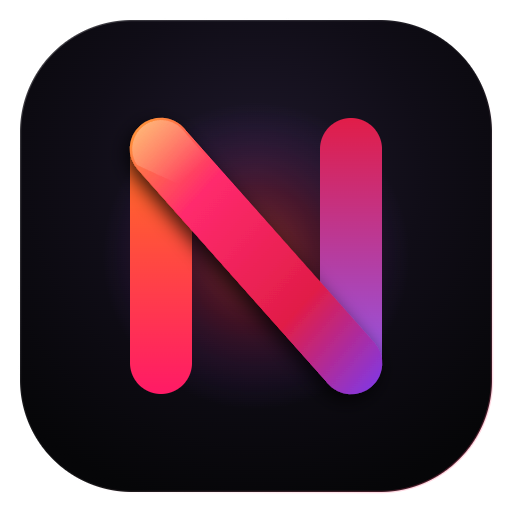

<div align="center">

  

  # Nuvio Web Enhanced

  <p align="center">
    <strong>A next-generation in-browser streaming hub and hardware-accelerated media player.</strong>
  </p>

  <p align="center">
    <a href="https://nextjs.org"></a>
    <a href="https://www.typescriptlang.org"></a>
    <a href="https://tailwindcss.com"></a>
    <a href="./NuvioCorsExtension"></a>
    <a href="https://supabase.com"></a>
  </p>

  <p align="center">
    <a href="#overview">Overview</a> •
    <a href="#nuvio-cors-extension">CORS Extension</a> •
    <a href="#external-players">External Players</a> •
    <a href="#nuvio-library">Nuvio Library</a> •
    <a href="#installation--setup">Setup</a> •
    <a href="#credits">Credits</a> •
    <a href="#disclaimer">Disclaimer</a>
  </p>

</div>

---

## Overview

**Nuvio Web Enhanced** brings a desktop-grade streaming and media experience straight to your modern web browser. Designed around a dark glassmorphism aesthetic, it integrates Stremio addons, TMDB metadata, Trakt watch scrobbling, and IntroDB/Anime-Skip segment detection into a fluid, responsive client.

### Key Features

- **Advanced In-Browser Playback:** Powered by `movi-player` and `shaka-player` with native MSE/WebCodecs hardware acceleration for smooth 4K/60fps and HDR streams.
- **Cross-Platform External Player Handoff:** Seamlessly launch desktop media players with one click, preserving current seek time, stream title, and active external subtitles.
- **Nuvio Library:** Save, organize, and filter your favorite **Movies**, **TV Series**, and **Anime** with instant playback access.
- **Intelligent Subtitle Engine:** Custom subtitle parser supporting SRT/VTT overlays, language matching, auto-selection, and user styling (font size, vertical position, colors, outlines).
- **Dual CORS Strategy:** Built-in serverless edge resolver (`/api/resolve`) for universal mobile/desktop compatibility, coupled with a dedicated Chromium extension for zero-latency direct client streaming.
- **Continue Watching & Watch Progress:** Real-time resume progress synced cross-platform across profiles.

---

## Nuvio CORS Extension (Chrome, Brave, Edge)

Some debrid providers (TorBox, Real-Debrid via addon redirects) and media servers omit permissive CORS response headers on their CDN redirects. 

Nuvio Web Enhanced solves this with two complementary mechanisms:
1. **Built-in Serverless Edge Resolver (Universal Default):** Follows debrid redirects server-side and returns the final direct stream link. Zero video bytes are proxied; works out of the box on mobile, iPad, and all web browsers without any extension.
2. **Nuvio CORS Unlocker Extension (Client-Side Acceleration):** Unlocks streams directly on your device with zero proxy latency.

<div align="center">
  
  <p><strong>Nuvio CORS Unlocker Extension v1.0.0 (Manifest V3)</strong></p>
  <p>Available for <strong>Google Chrome</strong>, <strong>Brave Browser</strong>, and <strong>Microsoft Edge</strong></p>
</div>

### What the Extension Does

The extension uses the high-performance **Declarative Net Request API** (`declarativeNetRequest`) to adjust response headers directly in the Chromium networking stack:
- `Access-Control-Allow-Origin: *`
- `Access-Control-Allow-Methods: GET, PUT, POST, DELETE, HEAD, OPTIONS, PATCH`
- `Access-Control-Allow-Headers: *`
- `Access-Control-Expose-Headers: *` *(Exposes byte-range headers critical for HLS/DASH/MP4 seeking)*
- `Cross-Origin-Resource-Policy: cross-origin`

### How to Install the Extension

The ready-to-use extension is packaged in [`releases/nuvio-cors-extension-v1.0.0.zip`](./releases/nuvio-cors-extension-v1.0.0.zip).

#### For Google Chrome:
1. Download [`releases/nuvio-cors-extension-v1.0.0.zip`](./releases/nuvio-cors-extension-v1.0.0.zip) and unzip it into a folder (or use the repository's `NuvioCorsExtension/` folder).
2. Open Chrome and navigate to `chrome://extensions/`.
3. Enable **Developer mode** via the toggle switch in the upper-right corner.
4. Click **Load unpacked** in the top-left corner.
5. Select the extracted `NuvioCorsExtension` directory.
6. The extension is now active with its popup controller in your browser toolbar!

#### For Brave Browser:
1. Open Brave and go to `brave://extensions/`.
2. Enable **Developer mode** in the top-right corner.
3. Click **Load unpacked** and select the `NuvioCorsExtension` directory.
4. *(Note: Operates cleanly alongside Brave Shields; you do not need to disable shields).*

#### For Microsoft Edge:
1. Open Edge and navigate to `edge://extensions/`.
2. Turn on **Developer mode** in the left sidebar.
3. Click **Load unpacked** and choose the `NuvioCorsExtension` directory.

---

## External Player Support

Nuvio Web Enhanced supports launching external desktop players across **Windows**, **macOS**, and **Linux**.

### Supported Players & Protocols:
- **System Default (Universal Recommended):** Generates an Extended M3U playlist file with `#EXTINF`, `#EXTVLCOPT:start-time`, and `#EXT-MPV-OPTIONS:--start` which opens in your operating system's default media player.
- **mpv:** Direct protocol (`mpv://`) and full CLI generator with `--title`, `--start`, and `--sub-file`.
- **VLC media player:** Native protocol links (`vlc://` on Windows/Linux, `vlc-x-callback://` on macOS).
- **PotPlayer:** Dedicated Windows protocol (`potplayer://`) with direct seek and title parameters.
- **IINA:** Modern macOS player protocol (`iina://weblink`).

### Controls:
- **Single-Click:** Immediately launches your configured default external player.
- **Right-Click:** Opens the player selection modal to switch players, download `.m3u`, or copy CLI command.
- **Always External Mode:** Toggle in **Settings -> Playback** to automatically open all streams in your desktop player.

---

## Nuvio Library

Access your saved content anytime under the **Library** tab:
- **Categories:** Filter by **All Items**, **Movies**, **TV Series**, and **Anime**.
- **One-Click Add:** Add any title from the detail modal or use the **+ Add to Library** live TMDB search.
- **Playable Cards:** Click any card to launch the video player or stream selector.
- **Category Switcher:** Quick-switch items between Movie, Series, and Anime directly on the card hover menu.
- **Cloud Storage:** Integrated **TorBox** cloud library viewer to browse and stream your remote cloud files.

---

## Installation & Setup

### Prerequisites
- Node.js 18.x or 20.x+ (Recommended: `v22.x`)
- npm or yarn / pnpm

### Clone & Install Dependencies
```bash
git clone https://github.com/Biraj2004/NuvioWebEnhanced.git
cd NuvioWebEnhanced
npm install
```

### Environment Variables
Create a `.env.local` file in the root directory:
```env
NEXT_PUBLIC_SUPABASE_URL=your_supabase_url
NEXT_PUBLIC_SUPABASE_ANON_KEY=your_supabase_anon_key
NEXT_PUBLIC_TMDB_API_KEY=your_tmdb_api_key
```

### Development Server
```bash
npm run dev
```
Open [http://localhost:3000](http://localhost:3000) in your browser.

### Production Build
```bash
npm run build
npm run start
```

---

## Credits & Acknowledgements

- **Core Developer & Maintainer:** [@Biraj2004](https://github.com/Biraj2004)
- **Co-Developer & Contributor:** [@anilabhadatta](https://github.com/anilabhadatta)
- **Foundational Project & Inspiration:** Special thanks to the **Nuvio Team** — **Tapframe and friends** for creating the original Nuvio ecosystem and vision.

---

## Disclaimer

Nuvio Web Enhanced is an open-source media frontend designed for personal streaming and collection management. It does not host, store, or distribute any media files or copyright-infringing content. All stream scraping and debrid resolution are handled strictly via user-installed third-party Stremio addons and user-provided API credentials. Users are responsible for complying with the legal terms of their respective services and jurisdictions.

---

<p align="center">Made with ❤️ by Biraj2004, anilabhadatta &amp; the Nuvio community.</p>
